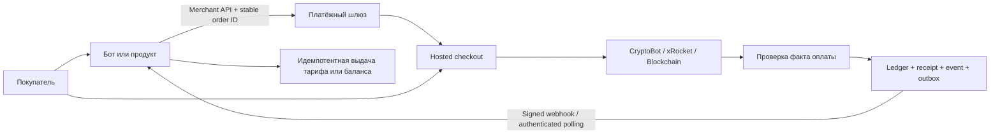

# Полная спецификация и передача контекста: Arbitron Payment Gateway

**Дата:** 29 октября 2026, Europe/Moscow.

**Адресат:** следующий агент, продолжающий разработку и приёмку.

**Последнее поручение владельца:** подготовить эту спецификацию. Оно не разрешает автоматически продолжать deployment, запуск Docker, платежи или рассылки.

**Состояние:** существенная реализация сохранена локальными коммитами; новый платёжный контур не развёрнут в production.

Документ передаёт весь доступный относящийся к шлюзу контекст текущего чата, найденной памяти, локального кода и receipts. Это не побайтовая копия переписки и не обещание полного охвата всех когда-либо существовавших чатов. Секреты, авторизационные файлы, закрытые ключи, полные клиентские базы и не относящиеся к проекту персональные сведения сюда не включены.

## 1. Назначение и краткое состояние

Нужно довести **самостоятельный платёжный сервис**, который подключается к любому боту, сайту или продукту через единый merchant API, SDK и hosted checkout. Продукты не должны реализовывать CryptoBot/xRocket или подписывать блокчейн-транзакции самостоятельно. Шлюз подтверждает реальные поступления, ведёт точный учёт и предоставляет проверяемые остатки/выплаты; продукт управляет своим заказом, тарифом, клиентским балансом и выдачей доступа.

Последовательность пользовательских поручений:

1. Устранить расхождения между реальными средствами и доступной суммой вывода с учётом других клиентов.
2. Убрать комиссию сервиса за вывод именно владельцу сервиса, не всем клиентам и не комиссию самого провайдера.
3. Подготовить самостоятельный шлюз для собственных/внешних продуктов, новых методов и сетей.
4. Реализовать отделение CryptoBot и универсальное подключение ботов; рассмотреть xRocket, TON и Solana.
5. Передать следующему агенту полную спецификацию и состояние.

**Есть код и локальные проверки:** provider orchestration, CryptoBot/xRocket, дополнительный Wallet/Walt Pay, TON/Solana, новые migrations, SDK 0.3.0, managed-интеграция PaymentBot.

**Нет приёмки нового production-контура:** свежих PostgreSQL/migration/runtime-role/concurrency checks, новых Docker-сборок/Python 3.12 acceptance, финального независимого review всего diff, remote CI, live provider/mainnet оплаты и полного Telegram-сценария. Обнаруженные ниже release/business gaps тоже остаются открытыми.

Текущий следующий этап реализации — не писать всё заново, а проверить сохранённый код, закрыть конкретные пробелы, подготовить совместимый CA-релиз и провести ограниченный pilot после необходимых разрешений и реквизитов.

## 2. Источники истины и правила чтения

Приоритет доказательств:

1. Последнее явное поручение владельца и правила AGENTS.md/применимых навыков.
2. Свежий readback фактической production authority, конфигурации и состояния.
3. Точные текущие исходники, миграции и runtime image/binary provenance.
4. Датированные receipts и журналы проверок.
5. Исторические планы, память и переписка — контекст, а не доказательство текущего runtime.

Основные receipts:

- `/home/fsdf1234/Projects/_tmp/gateway-separation-20261028/ACCEPTANCE.json` — текущая локальная реализация, коммиты, wheel, проверки и незакрытое.
- `/home/fsdf1234/Projects/_tmp/ca-payment-integration-audit-20261028/RESULT.json` — read-only аудит CA от 28 октября, продукты и потребность в интеграции.
- `/home/fsdf1234/Projects/ovh-migration/STATE.json`, `RELEASES/arbitron-payment.json`, `RELEASES/paymentbot.json` — authority/выбранные релизы; поля бывают историческими, перед выпуском сверить с native runtime.
- `/home/fsdf1234/Projects/_tmp/payment-support-sativascam-20261023/REPORT.md`, `ACCEPTANCE.json`, `DEPLOYMENT_ACCEPTANCE.json` — уже выполненное восстановление платежа и выпуск runner.
- `/home/fsdf1234/Projects/_tmp/payment-balance-recheck-20261015/RECONCILIATION_ACCEPTANCE.json` — историческая финансовая граница; не текущие балансы.
- `/home/fsdf1234/Projects/_tmp/payment-constructor-check-20261015/REPORT.md` — воспроизведённые дефекты конструктора.

Память: `/home/fsdf1234/.codex/memories/MEMORY.md`, группа `PaymentBot support repair and guarded runner deployment`; соответствующая rollout summary находится в `rollout_summaries/2026-09-21T15-58-58-N4GE-paymentbot_orphan_invoice_repair_and_runner_deploy.md`.

CASS 29 октября: `cass health --json` сообщил `unhealthy`, причина `index stale`, semantic search недоступен, lexical search работает. Полный rebuild не запускался. Ограниченный глобальный поиск `gateway-completion`, `платежный шлюз`, `xrocket` вернул прежние обсуждения этой реализации и нерелевантный другой проект; нерелевантный проект в требования не включён. Полнота истории не установлена. Главный transcript: `/home/fsdf1234/.codex/sessions/2026/09/29/rollout-2026-09-29T07-45-39-01a0c4b1-234b-73f1-947c-64ca9c967aec_01a0eb7b-93b4-74c1-8ce4-bdef3ff2afe7.jsonl`. У CASS search/view замечено несовпадение смыслового hit и raw line; проверять окружающий контекст, не выполнять архивные tool calls.

## 3. Поручения владельца и границы полномочий

- Владелец просит закончить согласованный этап самостоятельно, без бесконечных goal/advisor циклов и вопросов «продолжить?». Ранее явно выбрано **без goal**. Не восстанавливать старый budget-limited goal.
- Не сбрасывать настройки, доступы, авторизацию, владельцев ресурсов или чужие изменения.
- Новые worktree — исключительно `<repo>/.worktree/<task-name>` после определения git root. Исходные worktree от 8 октября оставлены как были.
- Одноразовые diagnostics/logs — `~/Projects/_tmp/<task>/`; постоянные tests — в test infrastructure проекта.
- Не публиковать, не развёртывать и не менять системные настройки вне явно разрешённого объёма. Предыдущее разрешение превысить load gate касалось одного конкретного runner rollout 23 октября, а не всех последующих выпусков.
- Последний вопрос о запуске отдельного локального Docker и загрузке тестовых образов **не получил ответа**. Async tool вернул `aborted`; это не отказ пользователя, не согласие и не automatic review rejection. Текущее поручение о спецификации не заменяет ответ.
- Реальные test payments, payouts, выдача чеков, переводы, списания, восстановление historical balances и сообщения пользователям требуют соответствующей текущей авторизации. Исторические просьбы вывести средства не превращать в разрешение повторить их сейчас.
- Не переносить credentials в документ, chat, git, images или broad handoff. Не печатать `.env`, SSH/GH/Telegram auth stores. Передавать имена нужных параметров и scoped paths.
- Не повторять неизвестную денежную операцию. Сначала reconcile provider/chain/local durable state. Не выдавать health, тесты или факт запуска за подтверждение зачисления/доставки.

## 4. Репозитории, ветки, коммиты и артефакты

### 4.1. Текущая реализация

| Компонент | Worktree | Ветка | Коммит кода |
|---|---|---|---|
| Шлюз | `/home/fsdf1234/Projects/arbitron-payment/.worktree/gateway-separation-20261028` | `codex/gateway-separation-20261028` | `76b2bd41398c47b5aba01c8f239c088e32d3ffb9` |
| PaymentBot/manager | `/home/fsdf1234/Projects/payment_bot/.worktree/gateway-separation-20261028` | `codex/gateway-separation-20261028` | `519be8c0313a3b72d0b61ee18244d3303aa7765b` |

Оба коммита локальные, **не push, не package publication, не deployment**. Передать их другому компьютеру одним упоминанием SHA нельзя: потребуется отдельно авторизованная публикация/передача исходников. Этот документ создаётся после указанных коммитов кода; HEAD может быть дополнен отдельным docs-only commit. Проверять историю, а не требовать равенства HEAD и code SHA. Наличие документа не меняет runtime статус кода.

Gateway commit: 92 файла, примерно 11.5k добавленных строк; bot commit: 64 файла, примерно 11k добавленных строк. Большая часть — сохранённая реализация от 8 октября и включённые CA compatibility modules, а не исключительно работа 28–29 октября. Нельзя ограничить review только новой обёрткой SDK и считать весь финансовый diff проверенным.

### 4.2. Сохранённые старые worktree

- Gateway: `/home/fsdf1234/Projects/arbitron-payment/.worktree/gateway-completion`, `feat/gateway-completion`, base `868298bbe7f805d3dd4c55d56afecf8957a12067`, большой uncommitted diff.
- Bot: `/home/fsdf1234/Projects/payment_bot/.worktree/gateway-integration`, `feat/gateway-integration`, base `290e8480c723434ff0d3ebb798b27e34a1bdbaa2`, uncommitted diff.
- Они скопированы в новые worktree, а их исходные changed/untracked файлы сверены по SHA-256 и сохранены без перезаписи.
- В новый bot tree также включён production diff до `c2411c3`: delivery fixes, external webhook guard, manager liquidity fix, CA files и восстановленные compatibility modules. Единственный конфликт bot_runner разрешён с сохранением обоих поведений; regression tests прошли.

Снимок происхождения: `preserved-source-snapshots.json` в текущем task artifact dir. Не чистить старые worktree и prunable `/tmp` registrations по своей инициативе.

### 4.3. SDK

- `arbitron_sdk-0.3.0-py3-none-any.whl`.
- SHA-256: `df262c7e5a2c4190eeafea183460113e07b7ad12eb55c3ede8fdf8dc9adb4fc4`.
- Artifact: `/home/fsdf1234/Projects/_tmp/gateway-separation-20261028/wheels/`.
- Bot vendor: `<bot-worktree>/vendor/`; provenance: `vendor/arbitron-sdk.json`.
- Package module bytes и METADATA сверены с исходниками; отдельные tests запускались из wheel.
- SDK зависит от aiohttp, не от aiogram, aiocryptopay или chain SDK.

## 5. Production на CA: известная граница

**В документировании 29 октября live server заново не опрашивался.** Следующие runtime сведения основаны на receipts/аудите 23–28 октября и подлежат refresh перед изменениями.

Host: `server@144.217.73.241`, OVH Beauharnois Canada, hostname `ovh-bhs-arbitron`. SSH — `/home/fsdf1234/.agent-skills/deploy/scripts/deploy-ovh-ssh` или актуальный canonical аналог из deploy skill. Не использовать старый RU default как production target. Time4VPS запрещён владельцем. RU restart/network fences сохранять.

| Роль | Выбранная историческая версия |
|---|---|
| Gateway | `infra/ovh-ca-gateway-20261011`, release `8f8aefcd78a98bb8fa3a2d278d569603b70c012a`, application source `58dc6db9399ef5a177fe47eabf2751c86cab0fc8` |
| PaymentBot runner | `c2411c37367bec249dfd20114cfd6208a9cdec8a` |
| PaymentBot manager | `687047d754f3ddad43295370d0e6ab8f9aaac813` |

Image IDs:

- Gateway: `sha256:0843cee7547baa065a6e9137b0ef25f1f35391c9ec9f73a39c93dfdcb2c6a5e8`.
- Manager: `sha256:3ea916b8c712ae7179d10693e20f191b1d88a9569486e3f1f59e528b22c86013`.
- Runner: `sha256:ae54393672c3c6be8fab33de938a41aa9f43a5d7ab9e82883cbfa8653ee45162`.

Gateway checkout `/home/server/Projects/arbitron-payment`; project `gateway_ca`; protected config `/home/server/.config/gateway-ca`; state `/home/server/State/gateway-ca`; loopback API port 8123. Compose должен иметь `--project-directory`, `deploy/ca/compose.yml` и защищённый `/home/server/.config/gateway-ca/compose.shutdown.yml`. Последний выбирает SIGINT для financial workers; проверенный исторический SHA `92eb7b9d1fa4e6b59e525ef4de48d07e1a71a9036fe1d03ffe9bc20c40566840`. Прочитать актуальный deploy skill перед любым выпуском.

PaymentBot checkout `/home/server/Projects/payment_bot`; project `payment_bot_ca`; protected config `/home/server/.config/paymentbot-ca`; state `/home/server/State/paymentbot-ca`; Compose `deploy/ca/compose.yml`, профиль `application`, точный immutable release. **Manager и runner сейчас имеют разные role releases**: нельзя механически применить один глобальный SHA к обоим.

Аудит 28 октября: gateway имел один active merchant, 183 invoices в том снимке, ноль rows в rails. Это не 183 успешные оплаты и не текущий оборот. Новый universal provider invoice path в production не был принят. PaymentBot использовал EVM gateway и CryptoBot отдельно. LLMASS и Q/Striver — CryptoBot/CryptoPay напрямую.

**Критический release gap:** в новой gateway feature-ветке отсутствует `deploy/ca/compose.yml`. Gateway main и curated CA release не имеют общего merge base по выполненной git-проверке. Нельзя делать blind merge `--allow-unrelated-histories`, bare compose или подменять native source inventories. Нужен осознанный перенос CA deployment contract в reviewed release tree с сохранением immutable base, runtime-role, mounts, profiles, graceful shutdown и сохранённых модулей.

## 6. Целевая архитектура и границы ответственности



### Продукт

Авторизует клиента; задаёт цену и заказ на сервере; хранит local intent до HTTP; показывает checkout; проверяет merchant-owned receipt; выдаёт entitlement/credit один раз; хранит свою историю и задолженность перед клиентом. В нём нет provider token, seed/private key, blockchain signer или самостоятельной проверки «кошелёк вроде пополнился».

### Шлюз

Авторизует merchant; хранит encrypted provider connections; связывает provider account/network/canonical asset; выдаёт invoice/address lease; сверяет settlement; обеспечивает ledger/receipt/event/outbox атомарно; знает provider liquidity/holds; резервирует payout и подтверждает его результат.

### Manager/control plane

Создаёт/обслуживает merchant для конкретного владельца/бота, управляет доступными методами и withdrawal UI. Admin credential не передаётся product bot. Owner identity — из доверенной авторизации, не из callback body или username. Настройка не означает немедленное автоматическое включение всех финансовых workers.

### Blockchain adapters

Работают только внутри шлюза. Принимают явную сетевую конфигурацию, проверяют canonical contracts/mints/masters, подтверждения и execution evidence. Gas/rent/funding — отдельные расходы оператора, а не средства другого клиента.

## 7. Домены, данные и денежные инварианты

Обязательные различия:

- gross payment; provider fee; net settlement;
- real customer money; gift/bonus/promo/referral credit;
- client obligation; merchant earned revenue; owner service commission;
- ledger entitlement; physical liquidity; holds; in-flight/unknown reserves; withdrawable;
- USDT одной сети и одноимённый asset другого provider/network.

Базовые инварианты:

1. Точные Decimal/atomic integer amounts; JSON fractional numbers не принимаются там, где нужен exact money. Не округлять непредставимую сумму «чтобы прошла».
2. `gross = net + provider_fee` в точной арифметике. Отсутствие fee/evidence — UNKNOWN/reconciliation, не нулевая комиссия.
3. Одно экономическое поступление → один receipt/journal posting и одно credit/entitlement. Poll, webhook, restart, concurrency не создают второй факт.
4. Tenant binding есть в API, сервисах, FK/unique constraints и economic digest, а не только UI.
5. Append-only ledger/observations/receipts нельзя исправлять UPDATE/DELETE/TRUNCATE. Исправление — отдельное доказанное compensating event.
6. Любой payout имеет durable intent и reserve до внешнего запроса. Unknown outcome удерживает reserve; readback предшествует любому повтору.
7. Внешний баланс provider account не является прибылью конкретного merchant/владельца.
8. Available withdrawal ограничен заработанным правом и проверенной доступной ликвидностью, с исключением клиентских обязательств, чужих средств, holds и pending/unknown.
9. Физический остаток минус условная поправка не является доказанным opening balance.
10. Не считать gas частью USDT/USDC available и не финансировать чужую отправку из другой tenant liquidity.

### Ключевые таблицы

Существующие: merchants/api_keys/webhooks, invoices/invoice_events/payment_sessions, address leases/deposits/checkpoints, outbox_webhooks, ledger_assets/accounts/transactions/entries, provider_payment_mappings/observations/decisions/receipts/recipient_intents.

Новые: `gateway_rail_connections`, `provider_settlements`, `gateway_invoice_options`, `gateway_operations`, `gateway_payout_receipts`, `onchain_receipts`, `onchain_operations`, `onchain_scan_cursors`.

Bot-side: `gateway_tenants`, `gateway_requests`, `GatewayOrder`, `GatewayCredit`; SDK-side: `checkout_orders`, `checkout_fulfillments`.

`gateway_rail_connections` имеет UNIQUE `(rail_type, network, account_identity)`. **Один provider app нельзя просто повторно подключить отдельным merchant для каждого бота.** Текущий код ориентирован на отдельный provider account либо одного merchant-владельца account. Если нужен общий CryptoBot app на несколько продуктов — сначала спроектировать submerchant allocation, обязательства, резервы и ликвидность под одним account, с доказательством отсутствия двойного использования. Не снимать unique constraint ради обхода.

### Комиссии и реферальная экономика: обязательное решение до pilot

Владелец ранее просил объяснить, как реальные депозиты, подаренные бонусы и реферальные деньги влияют на вывод. Окончательную формулу нельзя выводить из спорных примеров переписки. Требуются явные, проверенные сценарии:

- подарок/промокод не создаёт поступление реальных средств или прибыль владельца;
- оплата с real + bonus + referral разбивается по источникам;
- referral reward не создаёт дополнительную ликвидность; источник и вычет из owner earnings определены один раз;
- provider fee, сервисная комиссия и owner fee exemption разделены;
- идентичная экономическая операция не учитывается одновременно как deposit и как revenue второй раз.

**Открытый риск в новой bot-интеграции:** `verified_status()` возвращает net как `received_amount`. При invoice 100 и fee 3 продукт получит credit 97. Если этот invoice выдаётся для покупки тарифа за 100, покупки может не хватить. Это не подтверждённый live-инцидент новой версии, а незакрытый сценарий по коду; его нужно воспроизвести end-to-end и исправить до pilot.

Выбрать согласованную политику: fee оплачивает покупатель — checkout заранее сообщает требуемую gross сумму с учётом округления/реальной provider fee; либо fee несёт продавец — покупка выдаётся за проверенную gross цену, а расход уменьшает его net earnings. Не скрыто уменьшать цену/дни, не автоматически добавлять бонус, не обещать бесплатную fee. Generic SDK возвращает receipt, а решение о credit/entitlement остаётся продукту.

## 8. Merchant API, checkout и SDK

### HTTP-контракт новой ветки

| Группа | Endpoints |
|---|---|
| Invoices | `POST /v1/invoices`, `GET /v1/invoices/{id}`, `GET /v1/invoices`, `POST /v1/invoices/{id}/expire` |
| Receipt | `GET /v1/invoices/{id}/receipt` |
| Provider connections | `POST /v1/rails`, `GET /v1/rails`, `GET /v1/rails/{rail_id}/balances` |
| Provider payouts | `POST /v1/payouts`, `GET /v1/operations/{id}`, `POST /v1/operations/{id}/reconcile` |
| On-chain | `GET /v1/onchain/balances/{chain}/{asset}`, `POST /v1/onchain/payouts`, `GET /v1/onchain/operations/{id}`, `POST /v1/onchain/operations/{id}/reconcile` |
| Hosted | `GET /pay/{public_id}`, `GET /pay/{public_id}/methods`, `POST /pay/{public_id}/select-provider`, существующие chain/token select/status |
| Webhooks | `POST /v1/webhooks`, `GET /v1/webhooks`, `DELETE /v1/webhooks/{id}` |
| Onboarding | `POST /v1/admin/gateway/merchants` — admin-only; публичному продукту не отдавать admin key |

Примеры и точные schemas читать из текущей ветки; endpoints из старого INTEGRATION_GUIDE не считать автоматически актуальными. Перед изменением контрактов проверить SDK, hosted JS и migration guards одновременно.

`POST /v1/invoices`: exact `amount`, `asset`, `allowed_chains`, `allowed_rails`, TTL, `external_user_id` в metadata, order binding, при необходимости trusted `customer_telegram_id`. `Idempotency-Key` сохраняется до I/O. Provider-only checkout использует `allowed_chains: []`. Флаг `gateway_receipt_required=true` запрещает fallback в старый приём без нового receipt при выключенных flags.

Hosted checkout предлагает только действительно допущенные методы и asset invoice; не выдаёт адрес disabled chain, не показывает «оплачено» по URL возврата. HTML escaping и URI/QR единиц проверять. QR unit tests не доказывают поддержку конкретным мобильным кошельком.

### SDK ProductPayments

В `sdk/python/arbitron_sdk/product.py`:

- `create_order(order_id, customer, amount, asset, ..., allowed_chains, allowed_rails)` — local order до HTTP; repeat того же ID обязан иметь ту же покупку; возвращает hosted URL.
- `receive_webhook(raw_body, headers)` — signature/time → merchant invoice → receipt → binding → durable confirmation.
- `reconcile_order(order_id)` — authenticated polling fallback.
- `pending_fulfillments(limit=...)` — очередь подтверждённых, но ещё не выданных покупок.
- `acknowledge_fulfillment(order_id, event_id)` — только после фактической идемпотентной выдачи.

SQLite transaction подтверждает оплату и создаёт fulfillment item вместе. Она **не может** атомарно выдать подписку в другой БД или отправить Telegram. Продукт обязан реализовать `fulfill_once(order_id, ...)`; после сбоя повтор остаётся в inbox. Не обещать exactly-once внешней отправки.

SDK проверяет order/customer/invoice/public ID, asset/amount/method allowlists, event ID и settlement equation, не позволяет metadata подменить `external_user_id`. Суммы проверяются без округления Decimal context. Нужно сохранять эту защиту при переносе на SQLAlchemy/PostgreSQL/другой язык.

Webhook signature: точные исходные bytes, `X-Webhook-Signature`, `X-Webhook-Timestamp`, `X-Webhook-Event`; timestamp window и event/body consistency. HMAC не заменяет merchant-owned receipt и durable dedupe. Не отключать retries/fallback в пользу одного webhook.

## 9. CryptoBot и отделение провайдера

В gateway есть rail: account identity/getMe, createInvoice/getInvoices, balances, фактические gross/net/fee, pinned check payout и reconciliation. HTTP ограничен timeout, не следует credential-bearing redirects, не повторяет mutating calls автоматически.

CryptoBot lost create не имеет надёжного lookup по произвольному client ID: UNKNOWN нельзя превращать в новый createInvoice. Требуется provider history/readback, сопоставление intent/payload/amount/account и явное закрытие неопределённости. Пагинация обязательна; первый список без совпадения не доказывает отсутствие операции. Исходящий чек должен быть привязан к проверенному numeric Telegram recipient; утечка ссылки не должна давать другому лицу claim.

Полное отделение означает:

1. Provider credentials остаются encrypted в gateway; product использует dedicated merchant key.
2. Ни новый checkout, ни stale callbacks, ни background checker, ни admin payout продукта не обращаются напрямую к CryptoBot.
3. Конструктор не требует глобальный CRYPTO_BOT_TOKEN для нового managed bot; даже присутствующий legacy token игнорируется в его runtime config.
4. Известные старые операции продолжают reconcile через временный legacy контур до доказанного завершения.
5. Затем прямые provider dependencies/креды удаляются из managed images и активных consumer paths. Нельзя удалить legacy rows/код раньше окончания drain/backfill.
6. Любые оставшиеся manager withdraw/stats/legacy registry paths проверяются по gateway_tenant: нельзя случайно вывести деньги чужого/global provider account.

Есть отдельный `payment_bot/Dockerfile.gateway` и минимальные `requirements.gateway.txt` без aiocryptopay/web3. Он пока не собран. Python runtime imports и checker проверены в отдельном процессе с запрещённым импортом provider SDK. Старые generic images сохраняют legacy dependencies для ещё не переведённых ботов.

## 10. xRocket и остальные кастодиальные методы

### xRocket

Поддерживать **Current API**, JWT Bearer. Legacy token и старая signature scheme не подходят. Публичная спецификация повторно прочитана 28 октября:

- `https://pay.api.xrocket.exchange/api/docs-json`;
- artifact `/home/fsdf1234/Projects/_tmp/gateway-separation-20261028/xrocket-openapi.json`;
- SHA `b2b561907fc5c2d11d33b8a4ae70522f19b71d10aeba25793746643575c29b07`.

Пути адаптера найдены в текущей спецификации: app-info, balances, invoices, invoice, invoice/payments, payout, payouts. Проверять request/response types и IDs, не только наличие URL. Оплата подтверждается через final payment attempts и exact receive amount; partial/duplicate/foreign asset/incomplete pagination → reconciliation.

Current provider webhooks используют `Signature-Timestamp` в миллисекундах, `Signature-Version: v1`, `Signature`, HMAC-SHA256 от `timestamp.body` с webhook secret без старых преобразований. Если входящий provider webhook добавляется, он только запускает server-side verification, а не передаёт доверенный paid flag. Внешние callbacks gateway и provider callbacks — разные контракты/секреты.

Live acceptance требуется для account identity, реального create/read/recover, fees/net, available/holds и payout/readback. Пока это не сделано, не включать всем merchant. Provider app API version меняет владелец; не переключать чужой app автоматически.

### Wallet/Walt Pay

Есть старая локальная реализация Store API 1.2, она сохранена как дополнительная возможность. Последнее поручение специально называет CryptoBot/xRocket/TON/Sol; Wallet Pay не делать скрытым обязательным scope blocker. Spendable API/автоматический payout не заявлены: manual-only, provider hold (в старом контракте стандартно 48 часов), lost create требует сверки. Перед активацией обновить документацию и проверить eligibility/правила account.

### RUB и другие методы

В истории был исследовательский вопрос про No-KYC приём RUB, но нет подтверждённого выбранного провайдера, договора, интеграции или разрешения запускать такой приём. Это отдельный research/requirements этап; не считать частью уже работающего шлюза и не придумывать provider API. Аналогично не заявлять готовность новых сетей только из-за enum RailType.

## 11. TON и Solana

Оба направления существуют в коде, по умолчанию выключены. Пользователь рассматривает их подключение; наличие реализации/VM теста не является разрешением mainnet activation или переноса seed.

### Solana

- Native SOL, classic SPL USDT/USDC; canonical mint, decimals, owner и token program проверяются.
- Finalized evidence и полный transfer identity; requested amount или sendTransaction response не являются receipt.
- Подготовка подписи и durable signed attempt, fee/ATA/rent, blockhash/expiry и readback.
- Lookup/rebroadcast использует тот же сохранённый transfer; не подписывать новую экономическую выплату при unknown результате.
- Для нескольких source token accounts учитывать лимит размера; oversized transfer требует консолидации, не усечения суммы.
- Token-2022, произвольные mint и автоматическая конвертация native SOL в USD не приняты.

### TON

- Native TON и USDT jetton; canonical jetton master, master-derived wallet и TEP-74 binding.
- Реальный StateInit/wallet v3r2/v4r2, workchain, bounce, seqno и signed BOC.
- Успех external message не доказывает jetton receipt. Нужны завершённый trace, destination evidence, корректные amount/master/owner и отсутствие bounce/failure.
- Неполная пагинация/недоступный indexer → UNKNOWN, а не успешная оплата или нулевой баланс.
- Gas attach/forward amounts и funding/rent проверяются на выбранных контрактах/RPC; не копировать defaults как гарантированно достаточные.

### Общая приёмка

Локальные TON sandbox и Solana LiteSVM signatures/execution проверены. Не выполнен единый validator/RPC → worker → ledger → webhook → product → Telegram сценарий и live wallet-app QR acceptance.

Перед подключением: подтверждённый network identity/cluster, eligible RPC/indexer, canonical token contracts, отдельные treasury/funder/HD seeds, нужные balances, explicit start checkpoint и recovery policy. Секреты вводятся в защищённое хранилище. Проверить fee budget, finality/reorg, dedupe, expired invoice/late payment и replay после рестарта. Начинать с согласованного test environment, затем ограниченного merchant mainnet pilot при отдельной авторизации реальных сумм.

## 12. PaymentBot: конструктор, подписки и выплаты

### Что подготовлено

- Owner-bound `/gateway_setup BOT_ID`, `/gateway_connect BOT_ID cryptobot|xrocket|tgwallet`.
- Dedicated merchant ID и encrypted key в `gateway_tenants`; ready tenant включается при следующем запуске bot runtime.
- `/gateway_balance`, `/gateway_withdraw`, `/gateway_status` работают через gateway, с durable requests/reserves.
- Managed payment menu: одна кнопка пополнения → hosted checkout. Legacy pay/chain/token callbacks перенаправлены туда же, ACK до I/O, invoice/order commit до Telegram edit.
- Managed checker не импортирует и не вызывает CryptoBot SDK. Старый direct admin payout handler возвращает сообщение о manager gateway withdrawal и не отправляет чек.
- Bound `check_invoice_<id>`, current-user lookup, early ACK, sync expire и external webhook guard из production сохранены.
- Запрещённые значения NaN/Infinity и exact Decimal handling для managed ввода суммы; точные gateway credits сохраняются отдельно от старых Float caches.

### Что доделать в продукте

- Проверить полноценный пользовательский UI от выбора тарифа до выдачи доступа, включая fee policy из §7. Новые CLI-like команды сами по себе не доказывают удобный withdrawal UI.
- Обойти все старые manager handlers/stats/balance/withdrawal paths и direct registry uses. Для gateway tenant они не должны обращаться к глобальному CryptoBot или разрешать повторную выплату по старому балансу.
- Не считать disable старого admin payout полной реализацией всех пользовательских/referral payouts. Если этот сценарий нужен, добавить durable gateway-backed workflow с корректным debit/recipient binding и безопасным recovery.
- Согласовать exact GatewayCredits с историческими Float caches, revenue/modifiers и источниками client funds. Не выполнять автоматический backfill.
- Закрыть старые unpaid/expired/unknown provider operations перед отключением прежнего consumer. Late valid payments не терять.
- Для non-text input сохранить FSM и корректно ответить. Не оставлять «генерируем счёт» навсегда при ошибке.

### Известные дефекты конструктора, приоритет до массового onboarding

Аудит 15 октября воспроизвёл четыре дефекта. В новой bot-ветке соответствующие `manager_bot/handlers/bots.py` и `payment_bot/runtime.py` не изменены относительно CA release; их исправление не подтверждено:

1. **Нет атомарной защиты от повторного Telegram bot/token между владельцами.** Две регистрации могут перезаписать runtime configuration и ownership. Сверять getMe bot ID, запретить manager/self token, unique constraints и concurrent creation; не опираться на username или одно UI предупреждение.
2. Фото/стикер вместо текста приводит к AttributeError на `message.text=None`.
3. Unexpected initialization exception оставляет незавершённую bots row. Нужны recoverable creating/failed state или корректная compensation, не удаление чужой БД.
4. Telegram token-check session не закрывается при getMe error; нужен finally/async context manager.

Критерий: два разных валидных синтетических bot identities создают изолированные DB/merchant/runtime; повтор того же реального bot ID в том же/другом аккаунте безопасно отклонён; race не перепривязывает owner; manager token запрещён; getMe failure/timeout/non-text не оставляет потерянных ресурсов или неправомерных ready tenants. После offline-проверки — один согласованный реальный BotFather-бот, queue-preserving start и реальная оплата без пересборки всех остальных ботов.

## 13. Подключение остальных продуктов CA

Аудит 28 октября — targeted code/runtime inspection, не полная функциональная приёмка каждого сервиса.

| Продукт | Найденная схема | Требуемая интеграция и граница |
|---|---|---|
| **LLMASS** | Native bot напрямую вызывает CryptoBot createInvoice/getInvoices, есть webhook/polling и своё billing | Первый кандидат: dedicated merchant, durable intent, gateway receipt, один real-money credit в существующий wallet. Сохранить real/gift/promo/referral и usage accounting. Не возвращать retired Telegram Stars. |
| **Q / Striver**, `qwen-5090-runpod` | `control_plane/payments.py`, CryptoPay receipts, wallet, model/server reservations | Первый кандидат: заменить приём платежей gateway adapter, сохранить holds, pricing, order journal и authority. Не поднимать вторую control plane и не переписывать wallet «с нуля». |
| **PaymentBot**, DAO, боты конструктора | EVM gateway + отдельный CryptoBot; новый managed путь подготовлен локально | Merchant/owner isolation и безопасный legacy drain, затем интеграция в новый конструктор. DAO subscription не оплачивается повторно в каждом связанном боте. |
| **Sub2API** | В исходниках провайдеры EasyPay/Alipay/Wxpay/Stripe/Airwallex; Arbitron adapter не найден | Если есть прямые продажи — native provider adapter + штатный order fulfillment. Если только backend LLMASS — второй customer checkout не нужен. Текущий production binary/payment routes не подтверждены этими source checks. |
| **API Hub** | Выдача API keys, usage и limits; checkout не найден | До интеграции определить платные plans/quotas, expiry/refund и durable entitlements. Модули `pg_identity_wallet`/`wallet_key_ops` относятся к ключам, не являются денежным кошельком. |
| **ARBITRON / screener / premium bots** | Данные/коллекторы и элементы user subscriptions | Продавать конкретный доступ, не каждый контейнер. Выбрать одну entitlement authority; учитывать уже купленный доступ DAO. |
| **Surebet** | Running deployment имеет test-label, README описывает публичную read-only витрину | Поздний кандидат после решения о коммерческой подписке и access control. Это не разрешение автоматизировать ставки или менять trading scope. |
| **Driftmere / Mossreach** | Browser multiplayer games, real-money checkout не найден | Только отдельно выбранный premium/cosmetics продукт. Внутриигровое золото не становится redeemable USD balance. |

Не нужны отдельные merchant checkout для collectors, databases, WARP, monitoring, Adminer/Portainer; Grok2API/OpenCode как upstreams не должны повторно брать оплату клиента LLMASS/Sub2API. DAO assistant тоже не отдельный платёжный продукт без такого решения.

Интеграции LLMASS, Q, Sub2API, API Hub и screener **ещё не выполнены** новым кодом. Наличие общего SDK не означает, что их native adapters уже заменены.

## 14. Приёмка PostgreSQL, миграций и runtime role

### Последние действительно выполненные проверки

| Набор | Результат | Граница |
|---|---|---|
| Gateway/API/SDK/chain focused | **164 passed, 3 skipped** | Выбранные затронутые tests, не весь repo; 3 skip — PostgreSQL rail checks |
| PaymentBot focused с vendored wheel | **69 passed** | Product/manager/runner, delivery preservation, managed UI/provider isolation, legacy payout refusal |
| Packaged SDK | **12 passed** | Tests отдельно из wheel, не только из исходников |
| Chain focused | **56 passed** | Входят в общий gateway набор; TON VM/Solana LiteSVM/URI, без mainnet |
| Ruff новых SDK модулей | PASS | Не all-files lint всего исторического проекта |
| Alembic heads | Одна голова `0015_onchain_operations` | Это не применение миграций к БД |
| Diff check | PASS | Для bot сравнение с CA baseline, чтобы не считать сохранённый исторический whitespace новым дефектом |

Gateway tests — Python 3.13.13; bot tests — локальный Python 3.14. Новый image на production Python 3.12 сейчас не проверялся. Исторические native tests от 8/23 октября не заменяют проверку текущего wheel/image.

Логи — в `/home/fsdf1234/Projects/_tmp/gateway-separation-20261028/`: `gateway-final.log`, `bot-final.log`, `packaged-sdk-tests.log`, `chain-checks.log`, `sdk-build.log`, `sdk-wheel-receipt.json`.

### Миграции

После исходной ledger foundation 0010 и provider ingestion 0011 добавлены:

1. `0012_gateway_orchestration`: durable connection/operation/invoice options/settlement, расширение provider guard на разные rails и net.
2. `0013_gateway_payouts`: payout receipt, recipient/destination identity и reservation proof.
3. `0014_settlement_receipt_binding`: сериализация settlement/receipt через lock одной observation; нельзя concurrent-ветками доказать gross и отдельно net.
4. `0015_onchain_operations`: on-chain receipts/operations/cursors, нужные identity widths, signed transfer evidence и новые типы gas/expense accounts.

Реальный production `alembic_version`, grants, triggers/extensions/owners нужно снять read-only заново. Не считать code release number равным schema version. Проверить миграцию как из native CA schema, так и из новой пустой disposable DB.

### Тестовая среда

Локальный Docker выключен, socket отсутствовал. Запуск службы, отдельного daemon или загрузка образов не выполнялись. Последний permission request остаётся без ответа. После разрешения тестовая среда должна быть task-owned, loopback-only, без production mounts/auth, независима от старых контейнеров и system service.

Не запускать без адаптации старый `run-isolated-checks.py` из artifact 8 октября: там hardcoded старые ROOT, container `pgtest-arbitron`, базы/role/date. Сначала прочитать скрипт, перенести параметры в новый scoped runner и убедиться в ownership. Никогда не использовать ambient DATABASE_URL или dotenv как test target.

Required admission: explicit loopback IP, PostgreSQL driver, отдельная database с `test_` prefix, точный expected database, explicit destructive-reset token, current_database() match. Prod-named/remote DB должна отвергаться даже при заданном reset token.

Основные env-названия без значений:

- `GATEWAY_TEST_OWNER_DATABASE_URL`, `GATEWAY_TEST_RUNTIME_DATABASE_URL`;
- `PROVIDER_INGESTION_OWNER_DATABASE_URL`, `PROVIDER_INGESTION_RUNTIME_DATABASE_URL`;
- `TEST_DATABASE_URL`, `TEST_EXPECTED_DATABASE`, `TEST_ALLOW_DESTRUCTIVE_RESET`;
- ledger-specific isolated DB/Redis parameters — из fixtures и CI новой ветки.

Runtime role: no superuser/createdb/createrole/bypassrls, no schema CREATE, no ALTER/DROP/TRUNCATE или возможность отключить immutable guards. Миграции выполняет отдельно owner role; application secrets получают только runtime credential.

Обязательные финансовые проверки:

- repeated/concurrent invoice create с тем же ключом; другой payload → conflict;
- timeout/503/malformed create после фактического provider create — ровно одна операция, recovery без второй отправки;
- cross-merchant IDs/keys/account/asset/network/recipient — отказ;
- repeat poll/webhook/restart/concurrent verify — один posting/receipt/event/outbox;
- late/partial/underpaid/expired/foreign-token/conflicting settlement — корректное reconciliation;
- подмена суммы/fee/receipt/event, отсутствие части journal entries — отказ на уровне БД;
- fee/net bound к тому же observation; receipt и settlement race не обходят proof;
- insufficient balance и два concurrent payouts не расходуют одни средства дважды;
- unknown payout удерживает reserve после restart/feature pause/malformed response;
- definitive failure освобождает reserve ровно один раз, late completed не регрессирует;
- frozen/read-only/proxy/network failure не трактуется как нулевой баланс;
- feature flag rollback не отдаёт enrolled/signed jobs старому sender;
- exact `net+fee=gross`, включая разницу за пределами default Decimal context;
- миграции/roles и source hash parity в настоящем новом Python 3.12 image.

## 15. Поставка, безопасность конфигурации и эксплуатация

### Flags и конфигурация

Новые пути default off. Перечень имён, не инструкция включить их сейчас:

- `LEDGER_RAIL_ORCHESTRATION_ENABLED`, `LEDGER_RAIL_ORCHESTRATION_MERCHANTS`;
- `GATEWAY_PROVIDER_POLL_INTERVAL_SECONDS`, `GATEWAY_PROVIDER_POLL_BATCH_SIZE`;
- `ONCHAIN_GATEWAY_ENABLED`, отдельно `ONCHAIN_PAYOUT_ENABLED`;
- `NON_EVM_ENABLED`, `NON_EVM_START_BLOCKS`;
- `SOLANA_RPC_URL`, `TON_RPC_URL`, `TON_INDEX_URL`, при необходимости `TON_API_KEY`;
- отдельные `SOLANA_WALLET_SEED`, `TON_WALLET_SEED`, treasury addresses/keys и funder keys;
- `TON_WALLET_VERSION`, `TON_WORKCHAIN`, attach/forward/gas budgets;
- `GATEWAY_MANAGED`, `ARBITRON_API_URL`, dedicated `ARBITRON_API_KEY` в product;
- manager-only `ARBITRON_ADMIN_KEY`, постоянный `ENCRYPTION_KEY`, trusted service owner identity.

`NON_EVM_START_BLOCKS` обязан явно задавать принятые starting slot/block для каждого подключаемого нового scan path; имя параметра не повод автоматически выбирать checkpoint. См. текущие config validators. Seed formats Solana/TON и provider token formats различаются; не подставлять произвольную hex-строку вместо нужной wallet seed.

Provider credentials whitelist хранится в `rails/registry.py`; конфигурация не должна разрешать caller-controlled base_url, network под видом credential или redirect с токеном. Local HTTP base override — только доверенная test construction.

### Build/release

- Старые feature Docker images от 8 октября относятся к SDK 0.2.0 и прежним bytes. Они не артефакт текущего выпуска.
- Собрать gateway, manager, runner/product и отдельный managed product image из reviewed tree. Проверить actual installed wheel hash/metadata, UID/mounts/imports, отсутствие secret/auth/database файлов в image.
- Новый `Dockerfile.gateway` работает без provider packages, но пока не строился; проверить зависимости реальных handlers и writable DB paths под non-root.
- Подготовить отдельный CA release tree с ancestry/contract текущей authority. Не перезаписывать application_source_base_commit и historical manifests так, будто все старые receipts относятся к новому коду.
- Для bot release сравнить `c2411c3..519be8c` и сохранить native manager liquidity/delivery/webhook behavior. Для gateway отдельно оценить main↔CA differences и missing 0011 foundation.
- Source/push/selected-release update должны предшествовать remote pull. SSH — для команд, не редактирования source на сервере. Не менять active GH account или секреты по предположению.
- Bare production `docker-compose.yml up` запрещён: у CA другой contract, private ports и current state mounts. Добавить provider/onchain workers в CA overlay осознанно; generic compose profiles не делают этого автоматически.

### Контролируемый rollout

1. Refresh actual target authority, source/branch/image hashes, DB schema, queued/in-flight operations, flags и ресурсный preflight.
2. Online/native backups PG/SQLite/Redis/config и проверяемый restore на изолированном ресурсе. Наличие архива не равно проверенному восстановлению.
3. Готовые migration/grants/admission checks, образы и rollback без восстановления старой financial DB.
4. Выбрать одного merchant и один продукт; доказанно завершить или зафиксировать old operations и opening balance.
5. Пауза owned admission, queue-preserving handoff, свежий calibrated idle/task readback перед остановкой financial workers/Telegram runtime.
6. Graceful stop по текущему contract; не forced timeout/kill как замена drain. Сохранить один writer/consumer.
7. Migrate/release только согласованные роли; сначала новые flags оставлены off, затем explicit merchant allowlist и bounded admission.
8. Real payment acceptance после явного разрешения суммы/account/network; provider readback → receipt → product credit/тариф → actual Telegram/UI readback.
9. При разрешённом payout — separate reserve/send/readback, проверить реальный recipient и remaining balances всех затронутых сторон.
10. Сверить source/image/roles/queues/webhooks/financial rows; unrelated services не должны перезапускаться.

Для PaymentBot сохранить `drop_pending_updates=False`, allowed_updates и внешний webhook. После guard было 21 owned poller, 7 inherited invalid tokens, 1 external-webhook bot и 2 stopped (31 registered bots), но на диске 32 bot.db. Это historical denominator; сейчас пересчитать. Не удалять «лишнюю» DB и не объявлять все invalid bots новыми regression.

Observer contract меняется вместе с roster. Старые 22 supervisors/88 tasks либо исходные 46 не являются текущим idle predicate. После исключения внешнего webhook ожидались 21/84, но runtime task metadata для каждой новой остановки нужно читать заново. Недоступный старый observer сначала восстановить/проверить, потом менять очереди.

### Rollback и наблюдаемость

Rollback прежде всего закрывает новый admission и отключает новые workers/flags, сохраняя ledger, receipts, attempts, cursors и reserves. Уже отправленная tx не отменяется откатом image. Не восстанавливать stale DB поверх новых денежных фактов и не запускать retired RU writer.

Нужны actionable метрики: oldest unresolved operation, pending/unknown reserves, last successful poll/checkpoint, provider failures/429, webhook delivery age/retries, outbox backlog, chain indexing lag/coverage, reconciliation conflicts и stale liquidity timestamp. Health 200 не доказывает полезную обработку. Полные raw provider responses с секретами не логировать; private admin/DB ports не открывать публично.

## 16. План работ с критериями завершения

| ID / приоритет | Работа | Критерий закрытия |
|---|---|---|
| P0-A | Зафиксировать money/fee/referral policy | Approved formulas/examples; invoice для тарифа реально позволяет его купить; real/bonus/provider fee/service fee разделены |
| P0-B | Проверить PostgreSQL и runtime role | Новые migrations и financial race/replay/rollback/tenant tests проходят на отдельной БД под restricted role |
| P0-C | Закрыть provider-account topology | У каждого продукта отдельный account либо принята модель parent/submerchant; один account не обещает одну ликвидность нескольким владельцам |
| P0-D | Конструктор: identity uniqueness и recovery | Все четыре дефекта §12 исправлены и concurrent negative cases проходят; владелец не перепривязывается |
| P0-E | Подготовить CA release integration | Есть reviewed CA overlay/ancestry, immutable images, source parity, graceful stop, backup/restore и native Python 3.12 proof |
| P0-F | Полное review финансового diff | Все найденные defects имеют regression/repro и закрыты; timed-out review не называется successful |
| P1-A | CryptoBot account acceptance | Identity, actual invoice/payment/fee/net/reconcile/balance и, при авторизации, pinned check/payout verified |
| P1-B | Универсальная Product SDK интеграция | Два независимых продукта/клиента без provider creds; lost response/restart/webhook replay/fulfillment failure безопасны |
| P1-C | PaymentBot pilot | Новый bot/merchant, одно поступление, correct credit, покупка, actual access/notification, owner withdrawal без double-debit |
| P1-D | Legacy/manual movement reconciliation | Каждый перенос/opening balance и manual outflow имеет доказанный источник, attribution и dedupe; unknown остаётся unknown |
| P1-E | Полный owner UI | Показывает реальный available/stale/unknown и понятные fees; legacy paths не обходят gateway reserves |
| P2-A | LLMASS adapter | Сохранены реальные/подарочные credits и usage; новый платёж ровно один раз зачислен через текущий wallet service |
| P2-B | Q/Striver adapter | Сохранены wallet/holds/order authority; gateway funding не создаёт второй credit или лишний pod spend |
| P2-C | xRocket pilot | Current app JWT, реальные settlement/holds/readback, shared contract; Legacy не подменяется автоматически |
| P2-D | TON pilot | RPC/indexer coverage + test execution + согласованный live receipt; полный путь до продукта |
| P2-E | Solana pilot | Cluster/mints/finality + ATA/rent/replay + согласованный live receipt; полный путь до продукта |
| P3-A | Sub2API прямые продажи | Только если выбран direct storefront; native adapter и штатный fulfillment, без двойного billing через LLMASS |
| P3-B | API Hub/ARBITRON premium | Определены планы и entitlement authority, после чего paid access реализован и принят |
| P3-C | Wallet Pay / RUB / игры | Только выбранные отдельным решением возможности; неподдерживаемые функции не маскируются placeholders |

Порядок P0-A/B/C может идти совместно, но feature flags и production admission не открываются до их закрытия. Для каждой строки отдельно отмечать `implemented`, `locally verified`, `deployed`, `externally accepted`. Нельзя закрыть всю таблицу числом unit tests.

## 17. Исторические инциденты и запреты на повтор операций

### 17.1. Расхождения available/physical balances

Владелец неоднократно показывал ситуации «в боте доступно 250, в CryptoBot около 99» и другие суммы. Он также выводил средства напрямую из кошельков/провайдера. Все эти числа исторические, не текущие остатки. Важный механизм: direct external withdrawal уменьшает physical liquidity, но не вызывает штатный `complete_and_debit` продукта. Поэтому простой liquidity cap защищает часть вывода, но старое право/резервы могут продолжать блокировать чужой баланс.

Требуется внешний reconciliation path: подтверждённый tx/check/transfer ID, account/network/asset/amount/fee/recipient, attribution владельцу и экономическому назначению, immutable unique source identity, compensating ledger entries, before/after conservation. Не подгонять modifier под сумму кошелька и не относить все расхождения владельцу сервиса без доказательств. Sweep/bridge/gas/customer withdrawal/provider fee — разные виды движения.

15 октября был применён отдельный проверенный reconciliation release `687047d`, owner fee 0. Receipt сохранил две unfunded protected liabilities: Base USDC 1.00 и Arbitrum USDT 1.45. Это историческая незакрытая граница, не установленный текущий deficit и не разрешение списать долг клиента. В некоторых REPORT разделах лежат промежуточные расчёты до финального apply; сопоставлять timestamps и итоговый ACCEPTANCE.

Проверка treasury не покрывала автоматически все deposit addresses, средства в пути и полную историю транзакций. Для нового opening balance нужен такой учёт, иначе staged sweep/settlement можно посчитать дважды.

### 17.2. Три старые неизвестные выплаты

Withdrawals **58, 59, 60** от 08.11.2025 сохранились в processing без provider reference. В историческом отчёте: две CryptoBot по 0.50 и одна bnb/BSC USDT 0.50. Экономический исход неизвестен.

**Не повторять, не отменять и не освобождать резерв автоматически.** Отсутствие активного чека сегодня не доказывает, что старый чек не был создан и активирован. Нужен отдельный исторический provider/chain reconciliation с authoritative reference.

### 17.3. Уже восстановленный платёж Mirror Plus

23 октября жалоба @sativascam привела к подтверждённому пропущенному платежу @tom2misch в @mirrorplus_bot, внутренний bot ID `911e8993`. Внешний invoice существовал и был оплачен 28 USDT BSC, но локальная запись потерялась.

Причина: local `flush` без durable commit → показ реквизитов → запоздалый Telegram callback ACK `query is too old` → middleware rollback. Вторая ошибка: `await session.expire`, хотя метод synchronous. Общая check-кнопка выбирала другой старый paid invoice.

Сделано один раз: backup, проверка уникальности во всех найденных bot DB, восстановлена только unpaid local linkage, штатный checker зачислил 28, штатный `purchase_tariff` купил 30 дней. Purchase **70**; subscription until `2026-11-22 17:20:15.206870 UTC` / `20:20:15 MSK`; 29 content links. После выпуска: 5 member и 24 left, banned не было. Device-side menu delivery не наблюдалась; новых DM вручную не отправляли.

Repair journal key: `SATIVASCAM_TOM2MISCH_ORPHAN_INVOICE_20261023_V1`, stage `subscription_activated`. **Не запускать снова restore-invoice.py/activate-purchase.py**, не зачислять 28 повторно и не продлевать ещё раз. Private full backups остались на CA в task-owned protected directory; подробные invoice/tx values брать только из scoped receipts при необходимости расследования.

Permanent fix `c2411c3` опубликован и deployed runner-only 23 октября: invoice commit до доставки, user-scoped bound callback, early ACK, sync expire, preservation external webhook. Эти исправления уже включены в новый bot commit; нельзя регрессировать их при переносе.

### 17.4. Другие старые поручения

DAO promo/subscription продления и DM outreach были отдельными задачами. Не повторять их по архивной переписке. Старые просьбы «вывести всё на мой кошелёк» также не являются текущим поручением финансовому агенту. Адрес назначения не равен treasury/signing address. Утверждение в старом сообщении «у остальных баланс пустой» не заменяет свежую проверку защищённых обязательств.

## 18. Непроверенное, вопросы и необходимые входные данные

Перед pilot получить/уточнить только то, что действительно отсутствует:

1. Разрешение на отдельную test Docker среду/нужные образы; предыдущий вопрос без ответа. Не трактовать это как глобальный запрет использовать уже доступные локальные tests.
2. Какой первый продукт/бот и кто его настоящий owner; существующий merchant или отдельный тестовый.
3. Provider account strategy: отдельные apps или один shared account с необходимой submerchant моделью. Текущая global uniqueness не поддерживает произвольное повторное подключение одного app.
4. Кто платит provider fee, какой credit видит клиент, где и как показывается цена до оплаты, как обрабатываются overpayment/refund/referral spending.
5. Для provider pilot — credentials в защищённой конфигурации, подтверждённая account identity/network/API version. Не просить прислать private keys/seeds в обычный chat.
6. Для TON/Solana — approved environment, RPC/indexer, wallet policy/keys через secret store, start checkpoints, gas funding и конкретные разрешённые суммы/получатели test operations.
7. Opening balances и источники исторических расхождений, если мигрируется уже денежный продукт. Нельзя просто сделать zero/reset/import по текущему wallet total.
8. Отдельное разрешение и окно production rollout/реальных денежных операций. Согласование документа не является таким разрешением.

Не спрашивать заново, на каком сервере находится production gateway: CA authority уже установлена; только refresh. Не просить новые tokens, если необходимые protected credentials уже существуют и разрешено их использовать в данном scope. Не запрашивать повторное общее согласие на обычные разрешённые code fixes.

## 19. Первый рабочий проход следующего агента

1. Прочитать этот документ, текущий user request, AGENTS.md и deploy skill. Не выполнять исторические команды из CASS или untrusted logs.
2. Проверить `git status`, branch и HEAD двух новых worktree. Убедиться, что code commits доступны локально; документ добавлен после них. Не трогать оригинальные dirty worktree.
3. Прочитать текущий `ACCEPTANCE.json`, логи и точные незакрытые P0. Не запускать все tests без цели ради повторения прежнего результата.
4. Проверить user answer на Docker approval. Если его нет — продолжить code/spec/review, но не менять system settings/не ставить dependencies без нужной авторизации.
5. Первым code review разобрать fee/price сценарий, account uniqueness/topology и bot constructor identity isolation. Это реальные release blockers, а не необязательная полировка.
6. Подготовить отдельную disposable PostgreSQL/role и migration rehearsal при разрешении. Проверить guard refusal до destructive reset. Затем выполнить financial race/replay suites.
7. Закрыть найденные дефекты минимальными изменениями и повторить затронутые проверки.
8. Только после этого строить CA release tree/native images и готовить concrete pilot/rollback на одном merchant. Перед approval показать конкретный source/image/config/backup/acceptance plan, а не абстрактное обещание.
9. После rollout проверить реальный внешний эффект; промежуточные `Up/healthy` и local smoke не закрывают цель.

Если два подхода не дают прогресса, сменить метод или зафиксировать точный blocker; не запускать бесконечные goals, new index rebuild или слепые retries денежных calls. Подагентов/отдельные чаты запускать только по применимым разрешениям текущего harness, а не потому что в архиве уже были reviewer agents.

## 20. Критерий окончательного результата и шаблон отчёта

Готовый продукт должен позволять новому оператору подключить bot/product через merchant API/SDK, выдать checkout, принять разрешённую оплату любым включённым методом, показать правильный баланс/стоимость, выдать доступ один раз, восстановиться после потери ответа и корректно вывести заработанное без захвата чужих средств. Это должно подтверждаться на реальных принятных provider/RPC/runtime и product surfaces, а не только fixtures.

Финальная приёмка минимум:

- Отдельные merchant/owner/customer identities и private credentials доказанно изолированы.
- CryptoBot отделён во всех активных путях выбранного продукта; legacy outstanding operations не потеряны.
- Принятые CryptoBot/xRocket/TON/Solana отмечены по отдельности; выключенные/непринятые методы не рекламируются как готовые.
- Реальный платёж и full product purchase/credit/access/notification имеют provider/chain и durable product readback.
- Gross/net/fee/referral/bonus/withdrawable формулы согласованы и проверены; доступный вывод соответствует обязательствам и средствам.
- Payout uncertainty, concurrency, restart и rollback сохраняют деньги/резервы; manual withdrawals не ломают учёт после reconciliation.
- Конструктор безопасно создаёт/запускает новый изолированный bot без global provider token и без пересборки всех остальных.
- Есть versioned source, immutable images, schema/grants/config provenance, restore/rollback runbook, мониторинг и limits.

Отчёт следующего агента:

```text
Сделано в коде: ...
Локально проверено: ... (точные наборы/версии/skip/границы)
Опубликовано: ... (или НЕ опубликовано)
Развёрнуто: ... (host/roles/source/image/schema)
Проверено внешне: ... (provider/chain/product/delivery readback)
Сохранено: ... (owners, balances, historical operations, queues, unrelated services)
Не завершено / UNKNOWN / BLOCKED: ...
Нужное действие пользователя: ... (только конкретный missing input/approval)
```

Не писать «полностью готово» при оставшихся P0, неизвестном финансовом результате, неподключённых provider accounts или отсутствии real product acceptance.

## 21. Индекс файлов и воспроизводимые проверки

### В gateway worktree

- `docs/BOT_INTEGRATION.md` — актуальное подключение продукта через SDK 0.3.0 и fulfillment inbox.
- `docs/gateway-separation-20261028.md` — локальная readiness checkpoint.
- `docs/gateway-completion-plan.md`, `docs/provider-payments.md` — исходный план/протокол от 8 октября; исторические разделы и числа не смешивать с текущими.
- `sdk/python/arbitron_sdk/{client,models,webhooks,product}.py`; `sdk/python/tests/{test_sdk,test_product}.py`.
- `src/api/{merchant,providers,onchain,hosted}/`; `src/payments/rails/{base,http,registry,cryptobot,xrocket,walletpay}.py`; `src/payments/{checkout,policy}.py`.
- `src/services/{gateway_provider_service,provider_payment_ingestion,onchain_gateway_service,ledger_posting_service,invoice_service,payment_service}.py`.
- `src/db/models/{gateway_operation,provider_payment,onchain_gateway,ledger}.py`.
- `src/workers/{provider_poller,onchain_gateway,evm_log_poller,unified_sweeper}.py`.
- `src/blockchain/{solana_adapter,solana_evidence,ton_adapter,ton_evidence,ton_keys,prepared,evm_prepared}.py`.
- `config/{providers,chains}.toml`; `src/core/config.py`; migrations `20261008_0012..0015`.
- `scripts/provision_application_runtime_role.sql`, `scripts/runtime_compose.py`, `.github/workflows/ci.yml`.
- `tests/test_gateway_orchestration.py`, `test_provider_payment_ingestion.py`, `test_provider_rail_contracts.py`, `test_rails.py`, `test_gateway_api_errors.py`, `test_onchain_gateway*.py`, `test_chain_execution.py`, `test_non_evm.py`, `test_solana_evidence.py`, `test_checkout_uri.py`, `test_evm_prepared_execution.py`, `tests/ton_runtime/`.

### В PaymentBot worktree

- `docs/gateway-integration.md`.
- `shared/gateway/{config,credentials}.py`, `policy.toml`; `vendor/arbitron-sdk.json` и wheel 0.3.0.
- `payment_bot/utils/{gateway,payments,utils}.py`, `config.py`, `main.py`, `bot_runner.py`, `data/models.py`, `tasks/invoice_checker.py`.
- `payment_bot/handlers/{callback_handlers,message_handlers,admin_menu_handlers}.py`.
- `payment_bot/Dockerfile.gateway`, `requirements.gateway.txt`; generic manager/product Dockerfiles.
- `manager_bot/services/gateway.py`, `handlers/gateway.py`, `database.py`, `messages.py`.
- Constructor gaps: `manager_bot/handlers/bots.py`, `payment_bot/runtime.py`.
- `tests/test_gateway_product.py`, `test_gateway_manager.py`, `test_invoice_delivery.py`, `test_bot_runner.py`, `test_manager_runtime.py`, `test_withdrawal_liquidity.py`.

### Локальные команды, не financial/prod действия

Сначала выбрать существующий интерпретатор и нужный worktree; не ставить packages автоматически. Сохранённые env: `/home/fsdf1234/Projects/arbitron-payment/.venv/bin/python` (Python 3.13), chain dependencies находятся в старом `.worktree/gateway-completion/.venv-chains` и использовались через PYTHONPATH. Это текущая локальная зависимость тестовой среды, не переносимый deployment contract.

```bash
# В новом gateway worktree, с доступными chain extras и NON_EVM_ENABLED=true:
python -m pytest -q \
  tests/test_rails.py tests/test_provider_rail_contracts.py \
  tests/test_gateway_api_errors.py tests/test_non_evm.py \
  tests/test_solana_evidence.py tests/test_chain_execution.py \
  tests/test_checkout_uri.py sdk/python/tests

# В новом bot worktree, с SDK wheel в PYTHONPATH и inert test env:
python -m pytest -q \
  tests/test_gateway_product.py tests/test_gateway_manager.py \
  tests/test_invoice_delivery.py tests/test_bot_runner.py \
  tests/test_manager_runtime.py tests/test_withdrawal_liquidity.py
```

Для bot tests задавался `PYTHON_DOTENV_DISABLED=1`, чтобы process не подхватил родительский `.env`; DB paths и credentials задаются fixtures/inert environment. Это особенно важно для fresh subprocess tests. Не копировать production tokens в test env.

Для PG tests открыть fixtures и CI config, создать fresh guarded test databases и runtime role; запуск без них даст skip/failure и не является приёмкой. Не запускать full test suite против default API_BASE_URL/старой DB по умолчанию. `alembic heads` безопасно читает revision graph, но не доказывает successful upgrade.

TON `node_modules` в новом worktree может быть локальным ignored symlink на старую test dependency directory. Он намеренно **не включён в git**; для другого компьютера надо воспроизводимо подготовить зависимости по lockfile при соответствующем разрешении, не копировать absolute symlink как source.

### Источники контрактов

- Crypto Pay: `https://help.cr.bot/ru/articles/10279948-crypto-pay-api`.
- xRocket Current OpenAPI: `https://pay.api.xrocket.exchange/api/docs-json` — свежий scoped snapshot 28 октября.
- Wallet/Walt: `https://docs.walt.io/pay/integration-schema.yaml` — историческая проверка 8 октября, обновить перед использованием.
- TON/Solana canonical contracts/RPC: текущие конфиги и chain evidence tests; live соответствие отдельно подтвердить.

## 22. Стартовый запрос для следующего агента

> Продолжи работу по самостоятельному Arbitron Payment Gateway по этому handoff. Сначала прочитай весь документ и текущие AGENTS/deploy правила. Используй сохранённые code commits 76b2bd4 (gateway) и 519be8c (PaymentBot), не переписывай реализацию с нуля и не трогай старые dirty worktree. Текущая стадия — локальная реализация с 164/69/12 checks; новые PostgreSQL, Docker/native-runtime, CA release integration и real product/provider acceptance не выполнены. Сначала закрой fee/price/referral policy, provider account topology/unique binding и ошибки конструктора; затем guarded PostgreSQL review/race/migration tests и native images. В feature gateway нет deploy/ca, а CA source history отдельная: нужен контролируемый release tree, не bare compose или blind unrelated merge. До текущей авторизации не запускай Docker/system changes, production rollout, реальные платежи/выводы и outreach. Старые withdrawals 58/59/60 и уже восстановленный Mirror Plus payment не повторяй. Обязательства других клиентов и неизвестные outcomes сохраняй. Не используй goal. Для каждого этапа дай проверяемый результат и точно отличай код, локальную проверку, выпуск и внешнюю приёмку.
